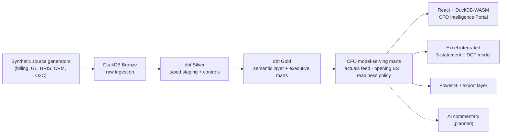
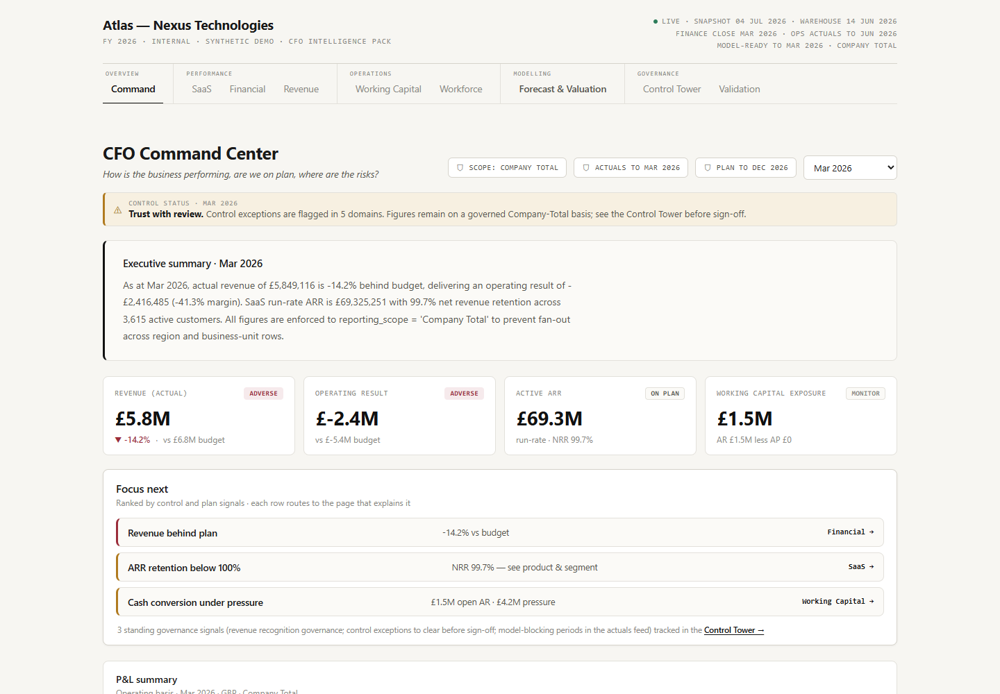
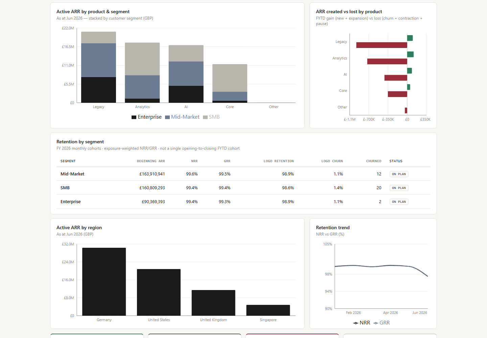
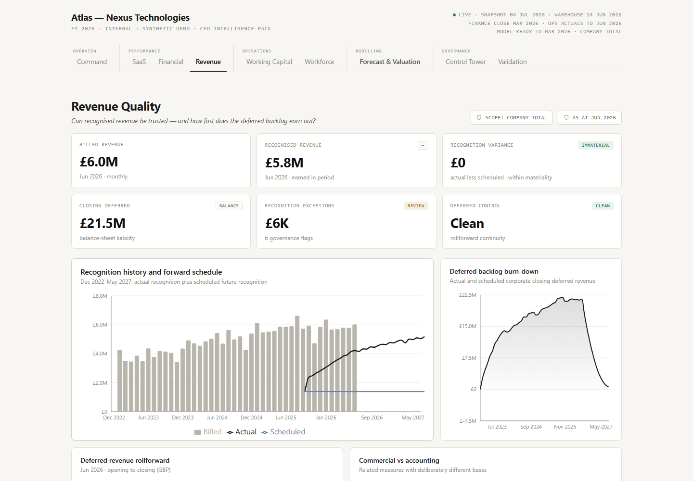
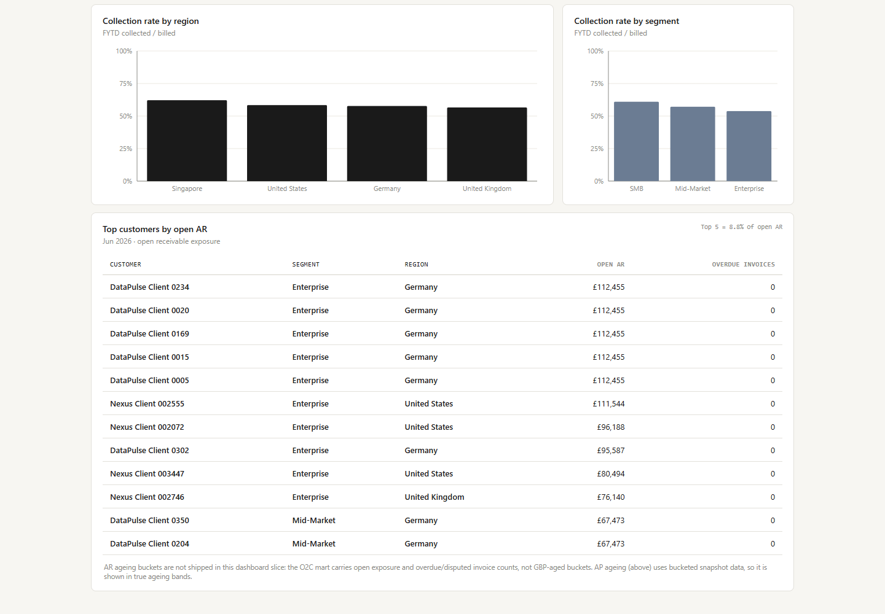
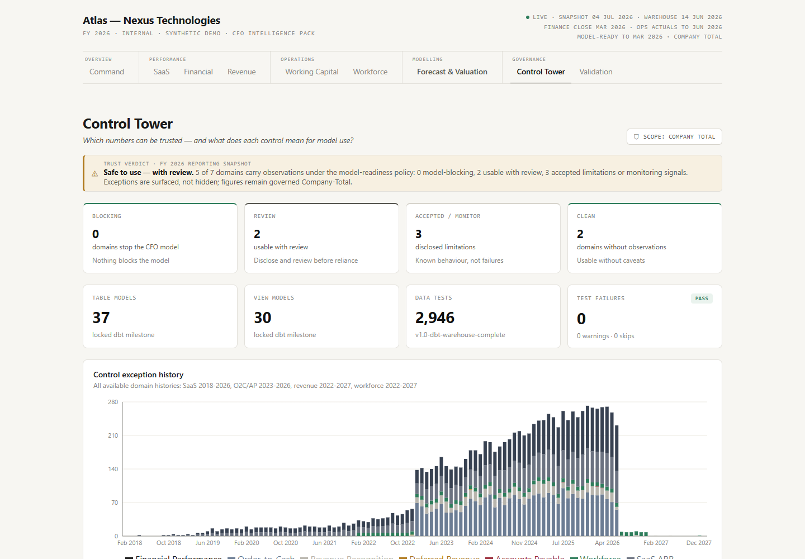
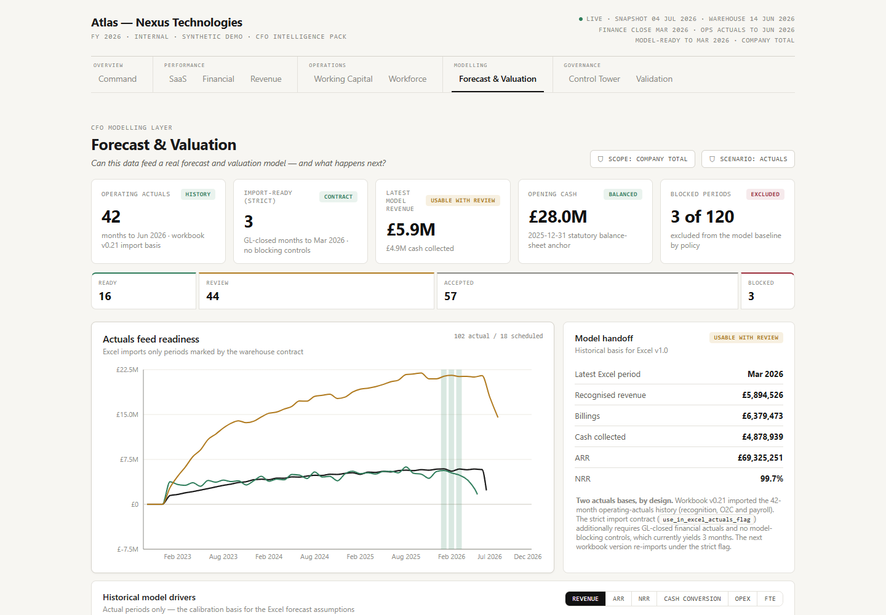

# Project Atlas — Finance Intelligence Platform

[](https://lewisa55.github.io/finance-intelligence-platform/)
[](https://github.com/LewisA55/finance-intelligence-platform/actions/workflows/deploy-dashboard.yml)
[](https://www.getdbt.com/)
[](https://duckdb.org/)

Project Atlas is an end-to-end finance analytics engineering portfolio project for a
fictional multinational SaaS company, Nexus Technologies.

**Atlas turns fragmented finance operations data into a governed CFO model and
intelligence portal.** It generates synthetic enterprise source data, loads a local DuckDB
warehouse, transforms and validates it through dbt, and serves governed CFO-ready marts to
three consumers from one contract: a live browser **CFO Intelligence Portal**, an Excel
integrated three-statement/DCF model, and a Power BI export layer — with AI commentary
planned against the same surfaces.

The project uses synthetic data only. It is designed for portfolio and demonstration purposes, not for production financial reporting.

**Nexus is deliberately imperfect.** The synthetic company is generated as a SaaS business
under operating pressure — revenue behind plan, ARR leakage, lagging cash conversion,
control defects, and a loss-making P&L — *on purpose*, so the governance layer has real
problems to catch, classify, and disclose. If a number looks uncomfortable, that is the
demo working, not the generator failing.

**Start here:** [Live dashboard](https://lewisa55.github.io/finance-intelligence-platform/) ·
[Architecture](docs/02_architecture.md) ·
[Gold semantic layer](docs/06_gold_semantic_layer.md) ·
[Validation summary](docs/final_validation_summary.md)

### Reviewing in 90 seconds

1. Open the [CFO Command Center](https://lewisa55.github.io/finance-intelligence-platform/#/command-center) — read the executive summary, then the ranked **Focus next** list.
2. Follow the top cue (revenue behind plan) into [Financial Performance](https://lewisa55.github.io/finance-intelligence-platform/#/financial) — the variance waterfall shows which departments drove it, and the model-feed bridge shows how the month lands in the modelling contract.
3. Finish on [Forecast & Valuation](https://lewisa55.github.io/finance-intelligence-platform/#/model) — the platform's differentiator: a governed actuals feed, per-domain coverage, a readiness policy that blocks unreliable periods, and the Excel model the warehouse serves.

## CFO Intelligence Portal (Live)

**https://lewisa55.github.io/finance-intelligence-platform/**

A static, browser-based **CFO Intelligence Portal** built on the governed Gold marts. It
runs entirely client-side — **React + Vite + DuckDB-WASM** query exported Gold Parquet slices
directly in the browser (no backend, no server, self-hosted wasm), enforcing scope-safe
Company-Total reads. The portal is organised around four connected experiences: the command
center ("what happened, are we on plan?"), performance & quality diagnostics ("why, and can
I trust the number?"), the CFO modelling layer ("can this data feed a real model?"), and the
forecast & valuation workspace ("what happens next?"). Pages:

- **CFO Command Center** — KPI spine, P&L summary, actual vs budget vs forecast, domain health tiles (including model readiness), and a ranked "where to focus next" routing layer.
- **SaaS Performance** — full-history ARR/NRR (2018–present with FY toggle), FYTD ARR movement bridge, product-family × segment mix and trend, retention by segment.
- **Financial Performance** — A/B/F trend, department × account variance, operating-result variance waterfall, and the bridge into the model-serving feed (FC_BASE_CASE explicit).
- **Revenue Quality** — recognition history and forward schedule, deferred-revenue backlog burn-down and rollforward, billings-vs-recognised bridge, governance exceptions classified by model-readiness treatment.
- **Working Capital** — cash conversion history, AR collections (by region/segment, top customers, concentration), AP ageing snapshot and trend, and working-capital model assumption hooks (collection %, DSO proxy).
- **Workforce Capacity & Hiring Pressure** — payroll/FTE actuals vs plan with a clean actual/plan split, forward hiring pressure with salary exposure, department controls by readiness treatment.
- **Forecast & Valuation** — the product anchor: governed actuals feed coverage, historical model drivers, opening balance sheet, readiness policy, and the Excel model workspace (download + handoff status).
- **Control Tower** — control exceptions by domain classified as model-blocking / accepted limitation / monitor, exception trends, and dbt validation evidence.
- **Data & Validation** — per-table row counts and coverage windows, manifest/freshness status, and the model-serving readiness summary.

See [dashboard/README.md](dashboard/README.md) for architecture and how to run it locally.

### Product architecture



The model-serving marts are the **shared contract**: Excel, the React portal, Power BI and
future AI commentary all consume the same governed actuals, opening balance sheet and
readiness classifications — documented in
[docs/12_cfo_modelling_layer.md](docs/12_cfo_modelling_layer.md).

### Visual Walkthrough

The live dashboard is the canonical interactive walkthrough.

[](https://lewisa55.github.io/finance-intelligence-platform/#/command-center)

| SaaS product and segment depth | Revenue recognition and deferred revenue |
| --- | --- |
| [](https://lewisa55.github.io/finance-intelligence-platform/#/saas) | [](https://lewisa55.github.io/finance-intelligence-platform/#/revenue) |

| Working capital and collections | Governed control evidence |
| --- | --- |
| [](https://lewisa55.github.io/finance-intelligence-platform/#/working-capital) | [](https://lewisa55.github.io/finance-intelligence-platform/#/control-tower) |

The modelling anchor — the governed actuals feed, readiness policy and Excel workspace:

[](https://lewisa55.github.io/finance-intelligence-platform/#/model)

## Why It Was Built

Nexus Technologies operates across the United Kingdom, United States, Germany, and Singapore. The company has grown rapidly, acquired DataPulse Analytics, and now faces common finance data challenges:

- fragmented source systems;
- inconsistent SaaS KPI definitions;
- multi-currency reporting complexity;
- budget, forecast, and actuals alignment;
- revenue recognition and deferred revenue control;
- executive reporting fan-out risk;
- auditability across finance transformation layers.

Project Atlas solves this by building a governed local finance warehouse with clear Bronze, Silver, and Gold responsibilities.

## Current Status

The governed warehouse, presentation-basis marts, model-serving layer, and live
React dashboard are complete for the current portfolio milestone.

| Area | Status |
| --- | --- |
| Synthetic raw source generation | Complete |
| DuckDB Bronze ingestion | Complete |
| dbt Silver staging and controls | Complete |
| dbt Gold semantic layer | Complete |
| Executive CFO Command Center mart | Complete |
| CFO presentation-basis marts | Complete |
| CFO model-serving marts and Excel handoff | Complete |
| CFO intelligence dashboard (React + DuckDB-WASM) | Live |
| Atlas Intelligence Portal / AI commentary | Planned |

## Final Validation Summary

Latest successful full build:

| Metric | Result |
| --- | ---: |
| Table models | 43 |
| View models | 32 |
| Data tests | 3,044 |
| PASS | 3,044 |
| SUCCESS | 76 |
| WARN | 0 |
| ERROR | 0 |
| SKIP | 0 |
| Runtime | 327.24 seconds |

## Tech Stack

| Layer | Technology |
| --- | --- |
| Source generation | Python |
| Local warehouse | DuckDB |
| Transformation | dbt |
| Validation | dbt tests and custom singular tests |
| BI / reporting layer | React + Vite + DuckDB-WASM (in-browser SQL over Parquet) |
| Intelligence layer | Grounded AI commentary, planned |

## Architecture

```text
Synthetic source generation
        |
        v
Raw CSV source files
        |
        v
DuckDB Bronze warehouse
        |
        v
dbt Silver staging and controls
        |
        v
dbt Gold dimensions and facts
        |
        v
Domain marts and executive marts
        |
        v
Executive CFO Command Center
        |
        v
React + DuckDB-WASM CFO dashboard (live) / Atlas Intelligence Portal (planned)
```

## Finance Domains Covered

- General ledger actuals
- Budget and rolling forecast
- Billing, invoicing, payments, and allocations
- Revenue recognition
- Deferred revenue rollforward
- Vendor invoices, payments, and AP ageing
- Workforce compensation, payroll, headcount, and hiring plan
- SaaS subscription events, ARR movement, and retention
- Executive finance performance and CFO command center reporting

ARR in this project represents commercial SaaS run-rate. It is not GAAP revenue. Revenue recognition and deferred revenue are modelled separately as accounting concepts.

## Gold Semantic Layer

Core Gold dimensions:

- `dim_date`
- `dim_gl_account`
- `dim_department`
- `dim_region`
- `dim_customer`
- `dim_vendor`
- `dim_employee`
- `dim_budget_version`
- `dim_forecast_scenario`

Core Gold facts:

- `fct_gl_actuals`
- `fct_budget`
- `fct_forecast`
- `fct_billing_invoices`
- `fct_billing_invoice_lines`
- `fct_billing_payments`
- `fct_billing_payment_allocations`
- `fct_revenue_recognition`
- `fct_deferred_revenue_rollforward`
- `fct_vendor_invoices`
- `fct_vendor_invoice_lines`
- `fct_vendor_payments`
- `fct_ap_ageing_snapshot`
- `fct_employee_compensation`
- `fct_payroll_expense_lines`
- `fct_headcount_snapshot`
- `fct_headcount_plan`
- `fct_subscription_events`
- `fct_subscription_periodic_states`

Gold marts:

- `mart_financial_performance`
- `mart_o2c_customer_collections`
- `mart_revenue_waterfall`
- `mart_deferred_revenue_control`
- `mart_ap_working_capital_control`
- `mart_workforce_cost_control`
- `mart_saas_arr_movement`
- `mart_saas_retention`
- `mart_executive_cfo_command_center`

The Executive CFO Command Center uses controlled reporting scopes to avoid joining incompatible grains:

- Company Total
- Region Total
- Business Unit Total

This prevents fan-out and double-counting when finance, customer, workforce, SaaS, AP, and revenue-control metrics are combined in the dashboard.

## How To Run Locally

Install dependencies:

```bash
pip install -r requirements.txt
```

Generate synthetic source files:

```bash
python scripts/generate_sources.py
```

Run source QA checks:

```bash
python scripts/qa/source_generation_qa.py
python scripts/qa/source_inventory_check.py
```

Load the DuckDB Bronze warehouse:

```bash
python scripts/warehouse/load_raw_to_duckdb.py
```

Validate Bronze:

```bash
python scripts/warehouse/bronze_validation_check.py
```

Run dbt:

```bash
dbt deps
dbt build
```

Generated raw data, warehouse files, dbt targets, and logs are intentionally ignored by Git.

### Run the dashboard

Requires Node.js 22+.

```bash
cd dashboard
npm install
npm run dev      # http://localhost:5173
```

The dashboard reads small committed Parquet slices in `dashboard/public/data/`. After a
new `dbt build` and Parquet export, run `npm run refresh-data` from `dashboard/`. That
single command copies standard exports, rebuilds the curated SaaS/O2C slices, writes a
SHA-256 manifest and validates the complete snapshot.

## Repository Structure

```text
docs/                  Portfolio documentation
dashboard/             React + DuckDB-WASM CFO dashboard (static, deployable to GitHub Pages)
models/                dbt Bronze sources, Silver staging, and Gold semantic models
macros/                dbt helper macros (incl. curated dashboard-slice export macros)
tests/                 dbt singular tests by finance domain
scripts/               Source generation, QA, and warehouse loading scripts
data/                  Local generated raw, processed, and warehouse outputs (ignored)
dbt_project.yml        dbt project configuration
requirements.txt       Python dependencies
```

## Documentation

Start with [docs/README.md](docs/README.md). For the reporting layer, see
[dashboard/README.md](dashboard/README.md) or the
[live dashboard](https://lewisa55.github.io/finance-intelligence-platform/).

## Reporting And Intelligence Layer

The reporting layer is delivered as the **live React + DuckDB-WASM dashboard** above, which
consumes the governed Gold marts and enforces scope-safe Company-Total reads. A Power BI pack
was originally planned ([docs/09_power_bi_reporting_plan.md](docs/09_power_bi_reporting_plan.md));
the React/DuckDB-WASM dashboard **supersedes it** as the realised BI layer, with the Power BI
plan retained as an alternative reference.

The planned Atlas Intelligence Portal / AI commentary layer will summarise validated mart
outputs only — it will not calculate finance metrics independently. The dashboard's narratives
are currently deterministic, generated directly from query results.

## Roadmap

- Wire the dashboard's deterministic narratives to a grounded LLM commentary layer (Atlas Intelligence Portal).
- Deepen pages as needed (e.g. product-level revenue recognition, true AR ageing slices).
- Add a concise architecture/lineage graphic and generated dbt lineage evidence.
- Add focused browser interaction and accessibility tests.

## Author

Lewis Andrews

Finance | Data | Analytics Engineering | Audit Technology
